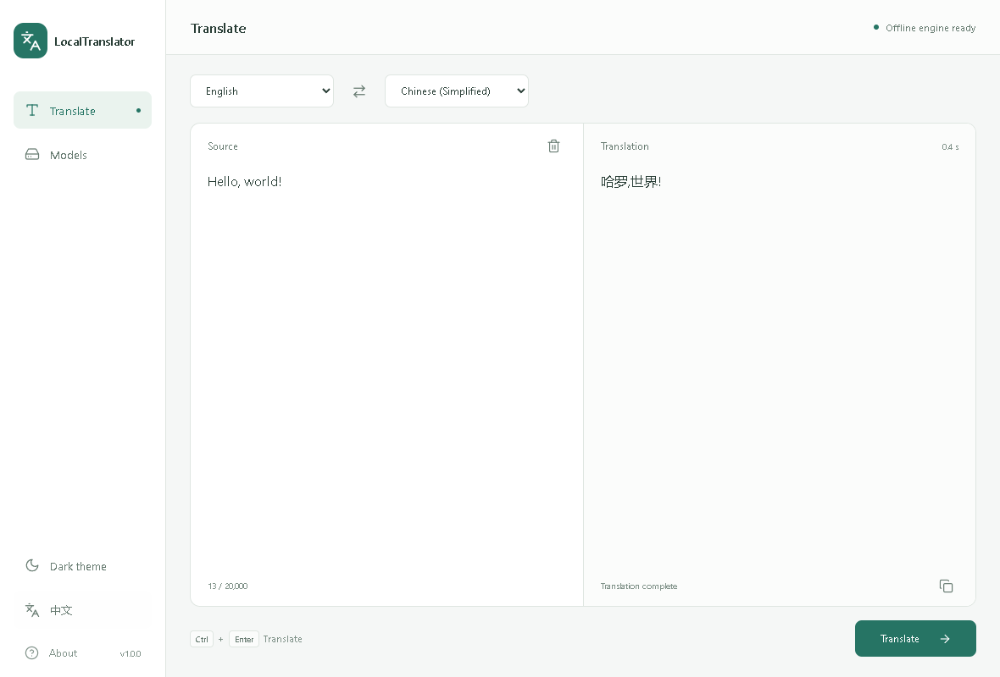

# LocalTranslator · 静译

[简体中文](README.md) | English



*Interface preview with synthetic sample text, rendered from the same frontend as the desktop app.*

Translate Chinese and English text locally on your CPU. The interface and inference engines are compiled into one EXE. Download models in the app, then translate offline.

- **Privacy first:** Input and output are processed in local memory, without sending text to a translation service or saving drafts, history or content logs. Translation works offline after model installation.
- **No application-level content restrictions:** The app adds no content moderation, keyword blocking or topic-based refusal rules. The 20,000-character per-request limit still applies.
- **Quality depends on the model:** Results may be disappointing, with awkward wording, mistranslations or omissions. Accuracy, fluency and completeness are not guaranteed, and performance can vary across topics and contexts.

## Download and run

Download `LocalTranslator_V1.0.0_Windows_x64.exe` from [Releases](https://github.com/woooooooooolf/LocalTranslator/releases/latest). Place it in a writable folder and run it. Python, Node.js, CUDA and accompanying application DLLs are not required.

Supported: **Windows 11 x64 / Windows 10 2004+ x64**, with [Microsoft Edge WebView2 Runtime](https://developer.microsoft.com/microsoft-edge/webview2/) installed. This release supports Windows only. Linux build/linking and privacy behavior need separate porting and validation; macOS is not offered.

On first launch, open **Models** and download English → Chinese or Chinese → English. Only an explicit download action contacts the official model sources. There are no background downloads or model updates. Once installed, translation works without an internet connection. Models can be deleted and downloaded again.

```text
LocalTranslator_V1.0.0_Windows_x64.exe
models/
  packages/    # Translation weights, tokenizer, configuration and attribution
  minisbd/     # Sentence-boundary models
```

Distribute the EXE alone, or include prepared `models/packages` and `models/minisbd` for offline machines. Do not distribute the temporary `.manager` or running `data` directories. Deleting a translation model retains less than 1 MB of shared sentence-boundary data.

## Use

The corrected direction defaults below are on the main branch and have not been released yet. The V1.0.0 executable retains its original defaults.

- Enter or paste up to 20,000 characters. Click **Translate** or press `Ctrl+Enter`. Clipboard writes require an explicit copy action.
- The interface starts in Chinese with English → Chinese translation. Select **English** in the sidebar to use English and automatically choose Chinese → English. Switching back restores English → Chinese. Existing input and output stay unchanged. Missing directions prompt you to download the model.
- Light/dark themes and expanding text editors are included. Interface language and manual theme choices apply only to the current session and are not stored in the browser.
- Text translation and copy only: no document import, translation history or translation file export.

## Local processing and models

Input and output remain in memory. The app does not write drafts, browser storage, content logs or translation caches. WebView2 runs in a separate temporary InPrivate session; autofill and password saving are disabled and verified through native settings. Sessions are cleaned up on exit, with abandoned sessions retried on the next launch. This is not secure erasure of Windows swap files or system crash dumps.

Only model downloads use the network. The download module takes fixed model IDs, never translation text or arbitrary URLs. Official Argos / MiniSBD downloads are checked against embedded SHA-256 values, extracted with limits and validated by loading the models before installation. Interrupted or cancelled downloads do not become usable partial models. See [model deployment](docs/MODEL_DEPLOYMENT.md) for sources and pinned checksums.

The current models are Argos 1.9 Chinese ↔ English, with CTranslate2, SentencePiece and MiniSBD on the CPU. Results depend on model capability and input context: the absence of application-level content filters does not mean the model can correctly understand or fully translate every text. Weights match the original tool, but the native Ruy backend may produce different wording from Python/MKL. Component licenses and model attribution are available in **About** and [third-party notices](THIRD_PARTY_NOTICES.md).

## Build from source

Requires Windows x64, Visual Studio C++ Build Tools / Windows SDK, Rust 1.99.0, Node.js 24, Python 3, CMake 3.28+ and Git. The scripts use Ninja bundled with Visual Studio. Python is build/test tooling only.

```powershell
npm ci
npm run native:core
npm run native:onnx
npm run portable
```

The first static-library build takes time. Upstream source revisions are pinned in the build scripts. The default output is a single named EXE in `release/LocalTranslator-V1.0.0/`. Use `npm run portable -- -IncludeModels` to optionally include models already prepared in the project.

```powershell
npx playwright install chromium
npm test
cargo test --locked --manifest-path src-tauri/Cargo.toml --bin local-translate
python scripts/fetch-model-catalog.py --verify
cargo test --locked --manifest-path src-tauri/Cargo.toml --bin local-translate cached_install_translate_remove -- --ignored --nocapture
```

UI regression tests use an isolated browser with mocked IPC. Model lifecycle tests load real weights and execute CPU translation in both directions. These checks do not replace native desktop acceptance. See [validation records](VALIDATION.md).

## Automated builds and releases

Code pushes to `main` and pull requests run Windows builds, UI/privacy checks and real-model tests. A `Vx.y.z` tag matching the project version publishes `LocalTranslator_Vx.y.z_Windows_x64.exe` and `SHA256SUMS.txt`. Workflow permissions are read-only by default; only the publishing job receives content-write permission. Releases are created only from tags. See the [release procedure](docs/RELEASE.md).
