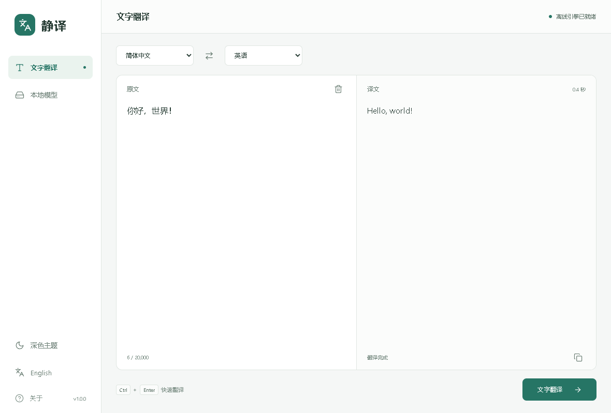

# 静译 · LocalTranslator

简体中文 | [English](README.en.md)



*界面预览，使用合成示例文本；由与桌面版相同的前端页面生成。*

在本机 CPU 上进行中英文文字翻译。界面与推理引擎编入一个 EXE，模型可在程序内按需下载，安装后可断网使用。

## 下载与运行

从 [Releases](https://github.com/woooooooooolf/LocalTranslator/releases/latest) 下载 `LocalTranslator_V1.0.0_Windows_x64.exe`，放在有写入权限的文件夹后运行。无需安装 Python、Node.js、CUDA 或附带应用 DLL。

支持 **Windows 11 x64 / Windows 10 2004+ x64**，需要系统已安装 [Microsoft Edge WebView2 Runtime](https://developer.microsoft.com/microsoft-edge/webview2/)。本版仅发布 Windows；Linux 的构建链接和隐私适配尚未验证，macOS 暂不提供。

首次运行进入“本地模型”，按需下载“中文→英语”或“英语→中文”。仅点击下载时访问官方模型源，不在后台更新或下载；下载完成后无需联网翻译。删除模型后可重新下载。

```text
LocalTranslator_V1.0.0_Windows_x64.exe
models/
  packages/    # 翻译权重、分词器、配置和模型署名
  minisbd/     # 分句模型
```

分发时只需 EXE；离线电脑可另行附带已准备的 `models/packages` 与 `models/minisbd`。模型管理使用的 `.manager` 和运行中的 `data` 不应随包分发。删除方向模型时，少于 1 MB 的共享分句数据会保留。

## 使用

- 输入或粘贴最多 20,000 字符，点击翻译或按 `Ctrl+Enter`；主动点击复制按钮才能写入剪贴板。
- 默认中文界面，侧栏可切换 English。英文界面自动选择“英语→中文”，切回中文自动选择“中文→英语”；切换不会改写输入或译文。对应模型缺失时会提示下载。
- 支持深浅主题，文本区域随窗口伸缩。界面语言和手动主题选择仅在本次运行中有效，不写入浏览器存储。
- 只提供文字翻译和复制，不提供文档导入、翻译历史或译文文件保存。

## 本地处理与模型

原文、译文在内存中处理，不写入草稿、浏览器存储、内容日志或翻译缓存。WebView2 使用独立临时 InPrivate 会话，原生关闭自动填充与密码保存，并读回验证，退出时清理；异常残留在下次启动清理。这不等于对 Windows 换页或系统转储进行安全擦除。

仅模型下载模块联网，接收固定模型 ID，不接收翻译文字或任意 URL。下载使用官方 Argos / MiniSBD 源、内置 SHA-256、受限解包及实际加载检查；失败或取消不会启用半成品。模型文件来源与固定校验值见 [模型部署说明](docs/MODEL_DEPLOYMENT.md)。

当前使用 Argos 1.9 中英双向模型、CTranslate2、SentencePiece 和 MiniSBD，纯 CPU 推理。工具不承诺翻译质量；权重与原工具一致，原生 Ruy 后端与 Python/MKL 后端的译文可能存在差异。组件许可和模型署名见程序“关于”及 [第三方说明](THIRD_PARTY_NOTICES.md)。

## 从源码构建

需要 Windows x64、Visual Studio C++ Build Tools / Windows SDK、Rust 1.99.0、Node.js 24、Python 3、CMake 3.28+、Git；Ninja 使用 Visual Studio 附带版本。Python 仅供构建和开发验证使用。

```powershell
npm ci
npm run native:core
npm run native:onnx
npm run portable
```

首次静态构建耗时较长，源码版本固定在构建脚本中。输出位于 `release/LocalTranslator-V1.0.0/`，默认只含命名后的 EXE。可选 `npm run portable -- -IncludeModels` 预附当前工程中的离线模型。

```powershell
npx playwright install chromium
npm test
cargo test --locked --manifest-path src-tauri/Cargo.toml --bin local-translate
python scripts/fetch-model-catalog.py --verify
cargo test --locked --manifest-path src-tauri/Cargo.toml --bin local-translate cached_install_translate_remove -- --ignored --nocapture
```

UI 回归使用隔离浏览器和模拟 IPC；模型生命周期测试实际加载权重并执行双向 CPU 翻译。两类证据不替代原生桌面人工验收。更多记录见 [验证记录](VALIDATION.md)。

## 自动构建与发布

推送代码到 `main` 或提交 PR 后运行 Windows 构建、UI/隐私检查和实际模型测试。推送与项目版本一致的 `Vx.y.z` 标签后，Actions 发布 `LocalTranslator_Vx.y.z_Windows_x64.exe` 和 `SHA256SUMS.txt`。工作流默认只有读取权限，发布任务单独获得内容写入权限；仅标签构建创建 Release。详见 [发布流程](docs/RELEASE.md)。
